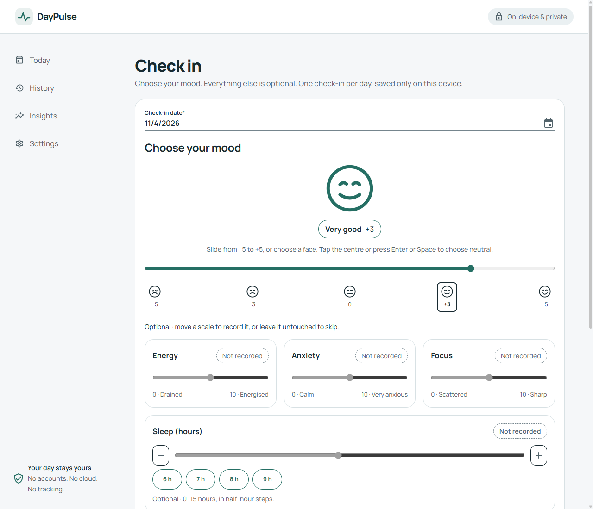

<div align="center">


# DayPulse

**Track your wellbeing. Understand your patterns.**

A privacy-first wellbeing journal, built as an installable .NET 10 Blazor WebAssembly app with MudBlazor.

[](https://github.com/kasuken/DayPulse/actions/workflows/azure-static-web-apps.yml)


</div>

Record mood, energy, anxiety, focus, sleep, activities and notes, then explore non-clinical trends. DayPulse runs in the browser without an application backend, accounts or analytics.

<p align="center">
  
</p>

[Download v1.0.0](https://github.com/kasuken/DayPulse/releases/tag/v1.0.0) · [Changelog](CHANGELOG.md)

> [!IMPORTANT]
> Data stays in this browser on this device. There is no cloud backup or synchronization.
> Export regularly from Settings. Downloads contain unencrypted personal data; store them privately.

## Features

- **Daily check-ins:** explicitly select mood, optionally add metrics, activities and notes, and save one entry per local calendar day.
- **History:** revisit actual entries, edit past values, or delete an entry after explicit confirmation.
- **Insights:** view 7/30/90-day averages, mood trends, streaks and mood extremes calculated from your own data.
- **Personalization:** choose optional metrics, system/light/dark appearance, and custom activities.
- **Data control:** export JSON or spreadsheet-safe CSV; confirm deletion of check-ins and custom activities and reset preferences.
- **Installable and offline:** use the published PWA after an initial online visit, with self-hosted fonts and mobile installation guidance.

First-run onboarding explains privacy and lets you choose metrics. The responsive UI includes keyboard focus, touch-sized controls and reduced-motion styling. English is enabled; German and Italian resources remain templates, not supported translations.

## Using DayPulse

1. Complete onboarding, then choose **Check in** on Today. One large expressive face reflects your mood: move the native -5 to +5 slider (all 11 scores), or use one of five face shortcuts. Mood stays unchosen until you interact; tap the resting centre thumb or press Enter/Space on the slider to explicitly choose neutral. Arrow keys and Home/End work natively. Optional energy, anxiety and focus sliders range from 0 to 10; sleep has a half-hour slider, step buttons and quick hour presets from 0 to 15 hours. Untouched optional scales stay unrecorded; **Clear** removes a recorded value. Notes allow up to 500 characters.
2. Save to open the entry detail. Use **History** to revisit, edit or delete entries. A date cannot contain two entries; a failed save keeps the draft visible.
3. Use **Insights** to select a period. Missing optional metrics are excluded from averages, not treated as zero. Streaks use local calendar days; the current streak may end yesterday when today's entry is not yet recorded.
4. Open **Settings** to choose metrics, manage activities, export data or delete it. Hiding a metric does not erase historical values; inactive activities remain associated with past entries.

Daily reminders are **best-effort while the app remains open**, with optional browser notifications. Closing the app stops reminders and background tabs may delay them. Use a device alarm or calendar for reliable scheduled alerts.

## Getting started

### Prerequisites

- [.NET SDK 10](https://dotnet.microsoft.com/download/dotnet/10.0), version **10.0.401 or a compatible later .NET 10 feature band**, as configured in [`global.json`](global.json).
- A modern browser with WebAssembly, service workers and browser storage enabled. Atomic repository writes also require the Web Locks API.
- Git to clone the repository.

### Run locally

```powershell
git clone https://github.com/kasuken/DayPulse.git
cd DayPulse
dotnet restore DayPulse.sln
dotnet run --project src\DayPulse.App --launch-profile http
```

Open <http://localhost:5084>. For HTTPS, trust the development certificate with `dotnet dev-certs https --trust`, then use `--launch-profile https` and open <https://localhost:7010>.

> [!TIP]
> Development uses a network-first service worker; published builds use cache-first behavior. Test installation, offline reload and upgrades against the published app over HTTPS (or localhost), not by opening `index.html` from disk.

## Configuration and privacy

Local development needs no API keys, connection strings, cloud account or backend database. The launch profiles set `ASPNETCORE_ENVIRONMENT=Development`; Azure serves the published app as static files.

Settings and repository data use browser localStorage; IndexedDB storage services are also registered. Browser storage is specific to an origin, browser and profile. There is no cloud synchronization or application-managed backup, and clearing site data can remove it.

> [!IMPORTANT]
> Choose the final HTTPS domain before inviting users to store data. Moving from an Azure hostname to a custom domain does **not** move browser-local data. Export is available, but importing an export is not yet supported.

DayPulse is not a medical application, diagnostic tool or substitute for professional support.

## Development

```powershell
dotnet build DayPulse.sln --configuration Release
dotnet test DayPulse.sln --configuration Release --no-build
dotnet publish src\DayPulse.App\DayPulse.App.csproj --configuration Release --no-restore --output publish
```

Warnings are errors. The test runner is Microsoft.Testing.Platform with xUnit v3 and bUnit; tests cover journal workflows, validation, repositories, deterministic statistics, onboarding, export/deletion, settings, localization and PWA assets. Automated component tests do not replace real-browser offline/update checks.

The static deployment directory is `publish\wwwroot`, not `publish`. Contributor guidance is in [AGENTS.md](AGENTS.md).

## Architecture

```text
src/
├── DayPulse.App/            Blazor WebAssembly host: pages, layout, theme, localization, PWA assets
├── DayPulse.Core/           Domain entities, validation, repository interfaces (no UI or storage dependencies)
└── DayPulse.Infrastructure/ Browser storage and IndexedDB-backed repositories, DI registration
tests/
└── DayPulse.Tests/          Unit and component tests
```

Dependencies flow one way: `App → Infrastructure → Core`. The domain stays free of Blazor, JavaScript interop and storage concerns, so it is easy to test and evolve.

Theme tokens live in [`DayPulseTheme.cs`](src/DayPulse.App/Shared/DayPulseTheme.cs); shared responsive and focus rules live in [`app.css`](src/DayPulse.App/wwwroot/css/app.css). Manrope is self-hosted under `wwwroot/fonts/` with its font license.

## Localization

UI copy lives in [`Resources/SharedResource*.resx`](src/DayPulse.App/Resources) and is read through `IStringLocalizer<SharedResource>`. See the [localization notes](src/DayPulse.App/Resources/README.md) for how to enable additional languages.

## Deployment

The [GitHub Actions workflow](.github/workflows/azure-static-web-apps.yml) builds and tests pushes to `main`, publishes the app and attempts deployment to **Azure Static Web Apps**. Same-repository pull requests also attempt preview deployments; closing a PR closes its preview. Fork PRs run build/test without deploying.

### Hosting setup

1. Select or create the intended Azure Static Web App and obtain its deployment token.
2. Store the token as the GitHub Actions **repository secret** `AZURE_STATIC_WEB_APPS_API_TOKEN`. Never put it in source, a browser setting or a README.
3. Rerun a failed deployment or push an approved change to `main`. The workflow uploads `publish/wwwroot`.
4. Take the live URL from the successful deployment or the Azure resource's default hostname. For a custom domain, add and validate it on that resource, configure the required DNS records, and wait for HTTPS provisioning.
5. Verify `/`, `/check-in`, `/history`, `/insights` and `/settings` directly over HTTPS, installation, offline reload, persisted data and an upgrade from a previous published version.

SPA fallback, MIME types, security headers and caching rules are in [`staticwebapp.config.json`](src/DayPulse.App/wwwroot/staticwebapp.config.json). The app currently assumes deployment at the origin root (`/`).

### Production address and release artifacts

The intended production address is **https://www.daypulse.me**. Its Azure domain binding and HTTPS deployment have not yet been verified; publishing a GitHub release does not make the website live.

The `v1.0.0` release includes a ZIP of the published static site. Extract its contents directly into your static host's web root, preserving `staticwebapp.config.json` when using Azure Static Web Apps. The repository workflow needs `AZURE_STATIC_WEB_APPS_API_TOKEN`; the latest checked deployment failed because that secret was missing.

## Limitations

No cloud sync, encrypted storage, import/restore or reliable closed-app reminders; English only. Browser data can be lost when site storage is cleared or evicted. Complete mobile/browser acceptance checks on the final hostname, including installation, offline reload and service-worker upgrades, before inviting users.
